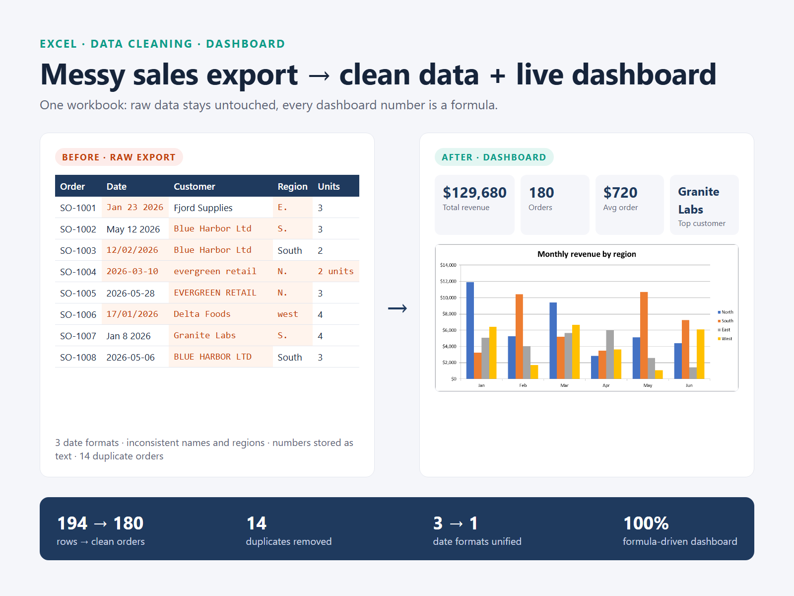
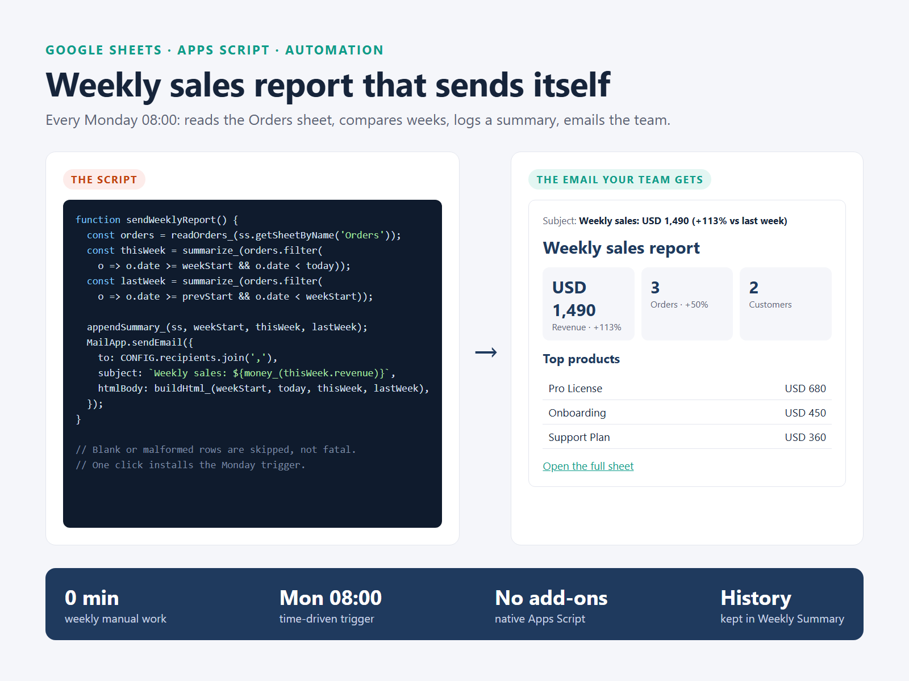
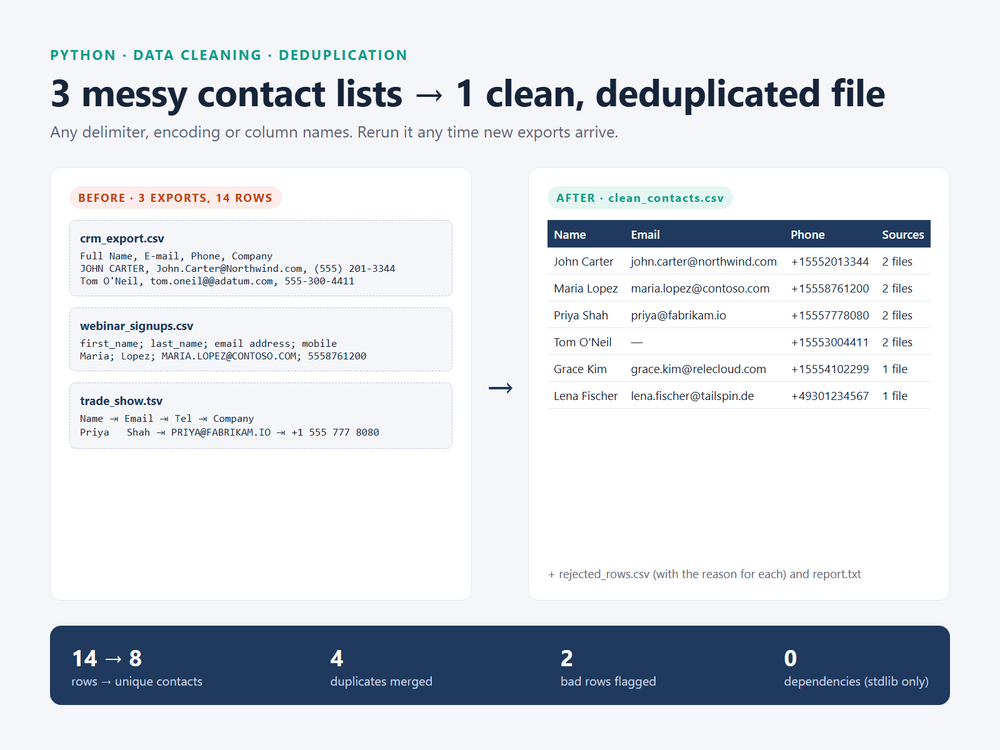

# Spreadsheets, Automation & Data Cleaning

Three runnable samples on demo data.

## 1. Messy sales export → clean data + live Excel dashboard

- [sales_cleanup_dashboard.xlsx](sales_cleanup_dashboard.xlsx): raw export (194 rows: 3 date formats, inconsistent names/regions, numbers as text, 14 duplicates), clean table (180 orders), cleaning log, and a dashboard where every number is a formula (SUMIFS, INDEX/MATCH) plus a chart.
- [build.ps1](build.ps1): the script that generates the workbook through Excel.

## 2. Weekly sales report that sends itself (Google Sheets + Apps Script)

- [weekly_report.gs](weekly_report.gs): every Monday it compares the last 7 days with the week before, logs a summary row and emails an HTML report. Skips malformed rows; one-click trigger install from a custom menu.

## 3. Merge & deduplicate messy contact lists (Python)

- [merge_contacts.py](merge_contacts.py): auto-detects encoding, delimiter and headers; normalizes names, emails and phones; merges duplicates by email or phone; writes a clean file, a rejected-rows file with reasons, and a report. Standard library only.
  `python merge_contacts.py INPUT_FOLDER -o OUTPUT_FOLDER`
